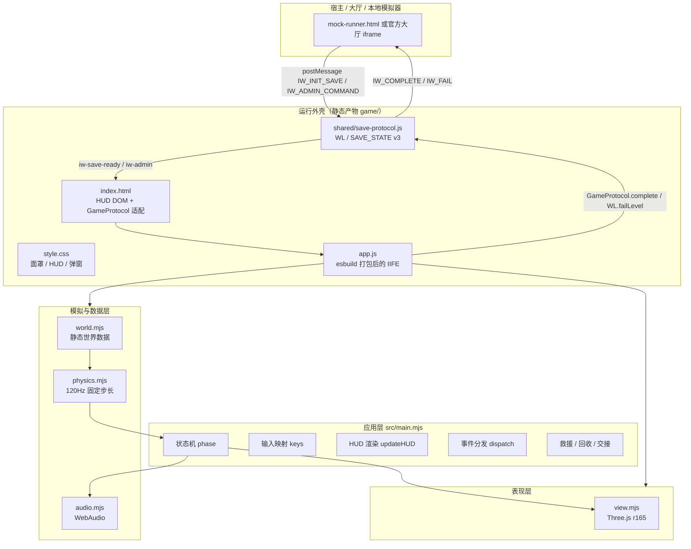
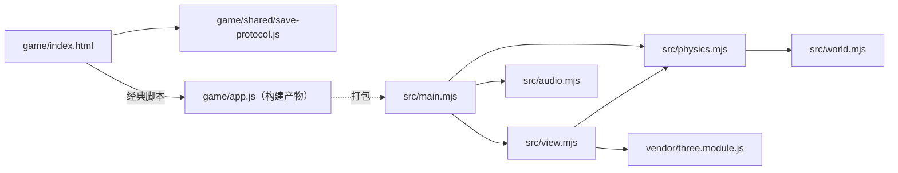
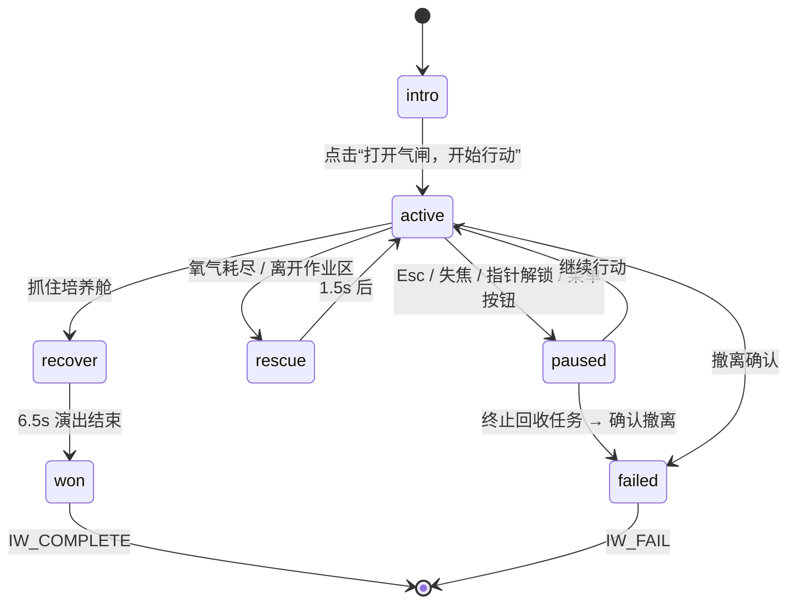

# 01 · 整体架构

## 1. 架构目标

这个项目不是常规“前后端分离”应用，而是一个**纯静态、单页、零网络的浏览器游戏**，同时要满足接力黑客松的宿主协议。因此架构围绕三个约束展开：

1. **可被隔离 iframe 加载**：产物必须是经典 `<script>`，不能依赖 ESM 的跨源加载、CDN 或线程能力。
2. **逻辑与表现分离**：物理模拟是纯函数式、无 DOM/无 WebGL 依赖的模块，便于 Node 测试。
3. **协议与玩法解耦**：官方 `save-protocol.js` 原样引入，游戏只调用 `WL.*`，不修改协议。

## 2. 分层视图



### 2.1 分层职责

| 层 | 代码 | 是否依赖浏览器 | 是否可单测 |
|---|---|---|---|
| 运行外壳 | `game/index.html`、`game/style.css` | 是 | 否（DOM 测试间接覆盖） |
| 协议层 | `game/shared/save-protocol.js` | 部分（无 DOM 时降级） | 是 |
| 应用层 | `src/main.mjs` | 是（DOM/指针锁定/RAF） | 是（JSDOM + 桩） |
| 模拟层 | `src/physics.mjs`、`src/world.mjs` | 否（纯 JS） | 是（Node 原生） |
| 表现层 | `src/view.mjs` | 是（WebGL） | 是（Three.js 对象 + 桩渲染器） |
| 声音层 | `src/audio.mjs` | 是（WebAudio） | 以桩替代 |

> `physics.mjs` 不 import Three.js、不访问 `window`/`document`，这是测试策略成立的前提。

## 3. 运行时形态

### 3.1 独立打开

```
浏览器 → game/index.html
        ├─ shared/save-protocol.js  (注入 window.WL)
        ├─ 内联脚本定义 window.GameProtocol
        ├─ app.js  (读取 WL.readSave()，进入 intro)
        └─ 用户点击开始 → 指针锁定 → 游戏循环
```

独立打开时 `window.parent === window`，通关分支不会调用 `GameProtocol.complete()`，只显示结局弹窗并标记 `handoffSent = true`；因此“成功跨关交接”只有在 iframe 中才能完成。若在独立页面手动调用 `completeLevel()`，缺少 `items`/`clues`/`exit_hook`/`world`/`nextWorld`/`nextUrl` 会返回 `null`，`finish()` 会提示“交接链路暂未确认，请重试”。

### 3.2 官方 iframe / 模拟器

```
父页面 iframe(sandbox=allow-scripts allow-pointer-lock …)
  └─ game/index.html
       ├─ WL 发送 IW_READY（load 时）
       ├─ 收到 IW_INIT_SAVE → 校验 protocolVersion → 写内存/持久化
       │   ├─ 设置 window.CONFIG（world / itemManifest / exitHook …）
       │   ├─ 派发 iw-save-ready
       │   └─ 回 IW_SAVE_ACK
       ├─ 通关 → WL.completeLevel() → postMessage IW_COMPLETE
       └─ 失败 → WL.failLevel() → postMessage IW_FAIL + IW_SAVE
```

沙箱没有 `allow-same-origin` 时 `localStorage` 会抛异常，协议库用内存变量兜底；游戏本身不直接使用 `localStorage`。

### 3.3 构建产物的「单文件」形态

[qa/build.mjs](file:///home/songyx-15x/Project/treaHackson/qa/build.mjs) 用 esbuild 把 `src/main.mjs` 及其依赖（含 `vendor/three.module.js`）打成 **IIFE 经典脚本** `game/app.js`：

- 避免 ESM 在 opaque-origin iframe 中的模块加载问题；
- 避免任何外部请求；
- 体积约 525 KB（未压缩源码逻辑 + Three.js r165）。

`game/vendor/` 仅保留 `LICENSE.txt`，因为 Three.js 代码已被打进 `app.js`。

## 4. 模块依赖关系



要点：

- `physics.mjs` 从 `world.mjs` 读取静态数据，并**再导出**这些符号，因此 `view.mjs`/`main.mjs` 只需从 `physics.mjs` 一处导入。
- `view.mjs` 只读取 `physics.mjs` 的数据与向量工具，不修改游戏状态。
- `main.mjs` 是唯一拥有可变 `state` 和 `save` 的模块。
- `game/index.html` 通过内联 `window.GameProtocol` 适配协议，避免 `app.js` 直接耦合 `CONFIG`。

## 5. 数据流

### 5.1 每帧数据流

```
requestAnimationFrame(now)
  ├─ wallDt = min((now - previous)/1000, 0.1)
  ├─ phase === active:
  │    accumulator += wallDt
  │    while accumulator >= 1/120:
  │        events = step(state, input(), 1/120)
  │        for e of events: dispatch(e)
  ├─ phase === rescue: 1.5s 后回 active
  ├─ phase === recover: 6.5s 演出，氧气插值到 100，镜头看向回收点
  ├─ 每 70ms: updateHUD()
  ├─ audio.update(state, active)
  └─ view.render(state, { recovery })
```

物理步长固定为 `1/120 s`，渲染跟随浏览器刷新率，二者解耦；不使用插值渲染（直接用最新状态），因为速度较低且画面以第一人称惯性为主。

### 5.2 状态所有权

| 数据 | 所有者 | 说明 |
|---|---|---|
| `state`（位置、速度、氧气、热量、漏点、胶带、抓握、岩石…） | `main.mjs` | 由 `initial()` 创建，`step()`/`interact()` 原地修改 |
| `save`（生命、道具、线索、钩子…） | `main.mjs` + `WL` | 存档由协议库提供；本游戏只在救援时 `setPlayer`、`respawn` |
| 键位集合 `keys` | `main.mjs` | DOM 事件维护 |
| 相机与场景 | `View` 实例 | 只读 `state` |
| 音频节点 | `SuitAudio` 实例 | 只读 `state` |

### 5.3 事件流

`step()` 返回事件数组，`dispatch()` 将其转换为「提示文本 + 音效 + 阶段迁移 + 画面震动」：

```
step → ["hit", "overheat", "capture", ...] → dispatch → tell()/audio.tone()/phase 变化
```

详细事件表见 [04-main-loop-and-input.md](./04-main-loop-and-input.md#5-事件分发表)。

## 6. 游戏状态机



| phase | 物理推进 | 计时 | 输入 | 说明 |
|---|---|---|---|---|
| `intro` | 否 | 否 | 仅开始按钮 | 开场简报、读取上家钩子 |
| `active` | 是 | 是 | 全部 | 正常游玩 |
| `paused` | 否 | 任务总计时继续 | 仅菜单 | 运动与氧气冻结 |
| `rescue` | 否 | 否 | 否 | 救援演出 1.5s |
| `recover` | 否 | 否 | 否 | 系缆回收演出 6.5s |
| `won` | 否 | 停止 | 无 | 已发送成功交接 |
| `failed` | 否 | 停止 | 无 | 已发送失败交接 |

> 「任务总计时」用 `performance.now() - startedAt` 计算，暂停期间继续走，这是设计选择。

## 7. 关键设计决策

| 决策 | 原因 |
|---|---|
| 固定 120Hz 物理步长 | 碰撞与热量/漏气数值稳定，测试可复现 |
| 物理纯函数、状态显式传入 | 可在 Node 中跑完整通关路线，无需浏览器 |
| 世界数据集中在 `world.mjs` | 关卡调参只改一张表；`BOXES` 由 `ANCHORS` 派生 |
| 交互用「视线夹角 + 距离 + 遮挡」而非射线拾取 | 无物理引擎依赖，手感可控，`occluded()` 防止隔舱取物 |
| 事件数组而非回调 | 主循环可以决定何时中断（如 `capture` 立即离开 active） |
| 所有美术/声音程序生成 | 满足包体、版权、零网络约束 |
| 协议库原样复制 | 官方要求不得修改；哈希记录在 `VERSION.json` |

## 8. 扩展点

- **新增检查点**：在 `world.mjs` 的 `ANCHORS` 中插入（注意 `checkpoint` 序号与顺序绑定），`BOXES` 会自动生成护板与顶棚，`View.makeStation()` 自动绘制。
- **新增补给/陨石**：`PACKS` / `ROCKS` / `METEORS` 增加条目即可；表现层自动实例化。
- **调整难度**：`physics.mjs` 顶部的加速度、热量、耗氧公式；`main.mjs` 的 HUD 阈值仅影响显示。
- **新增交互类型**：`focus()` 增加候选 → `interact()` 增加分支 → `dispatch()` 增加事件 → HUD `interact` 文案增加分支。
- **接入新协议版本**：替换 `game/shared/save-protocol.js` 并同步 `game/index.html` 的 `GameProtocol` 适配；不要改 `app.js` 内部逻辑。
