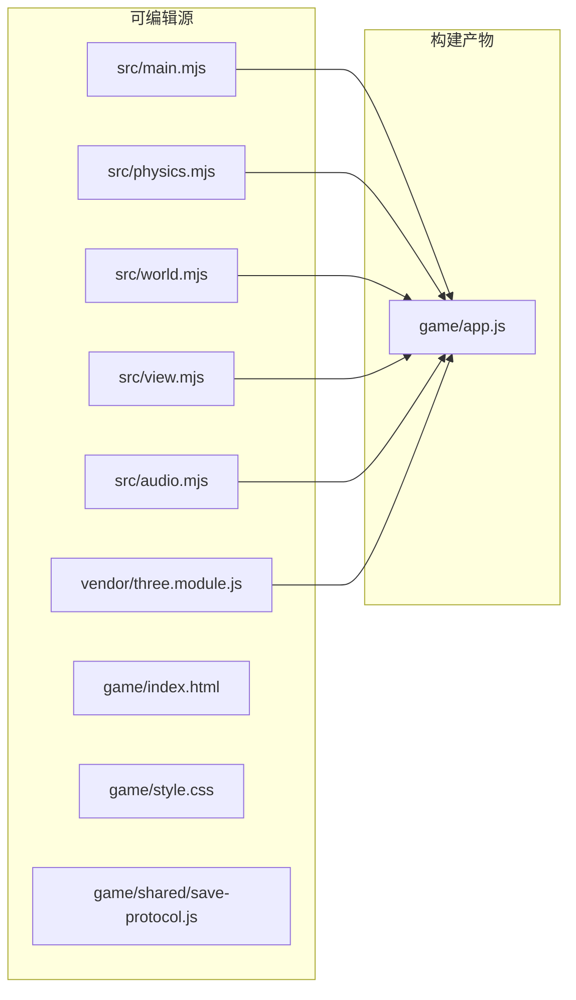

# 02 · 目录结构与依赖关系

## 1. 仓库目录总览

```text
treaHackson/
├── README.md                          # 项目说明与运行方式
├── package.json                       # npm 脚本与开发依赖
├── package-lock.json
├── 完整流程自测记录.md                 # 作者完整流程自测记录（验收材料）
├── src/                               # 可读源码（真正要维护的代码）
│   ├── main.mjs                       # 应用入口（635 行）
│   ├── physics.mjs                    # 物理与生存模拟（364 行）
│   ├── world.mjs                      # 世界静态数据（128 行）
│   ├── view.mjs                       # Three.js 表现层（632 行）
│   └── audio.mjs                      # WebAudio 音效（79 行）
├── vendor/
│   └── three.module.js                # Three.js r165（MIT，本地化）
├── game/                              # 构建后的运行产物（提交内容）
│   ├── index.html                     # 入口
│   ├── app.js                         # esbuild 打包产物（IIFE，约 525 KB）
│   ├── style.css                      # HUD / 面罩 / 弹窗样式
│   ├── global-items.json              # 跨关道具声明（空）
│   ├── shared/
│   │   └── save-protocol.js           # 官方 SAVE_STATE v3 协议库
│   └── vendor/
│       └── LICENSE.txt                # Three.js 许可证
├── qa/                                # 构建与质量保障脚本
│   ├── build.mjs                      # esbuild 打包
│   ├── physics.test.mjs               # 14 项物理/生存测试
│   ├── game-flow.test.mjs             # 7 项键鼠 + 协议流程测试
│   ├── scene.test.mjs                 # 2 项 Three.js 场景测试
│   ├── run.mjs                        # Playwright 浏览器验收
│   ├── pack.py                        # 打 ZIP + 官方自检
│   └── deploy.mjs                     # rsync 部署
├── participant-delivery-kit-v3.3.2/   # 官方交付工具包（只读参考，不打进 ZIP）
│   ├── AGENT.md                       # 开发宪章（硬性规则）
│   ├── README.md                      # 交付包使用手册
│   ├── 参赛团队 5 分钟接入指南.md
│   ├── 外链接力接入指南.md
│   ├── 正式交接规则-v3.2.md
│   ├── shared/save-protocol.js        # 与 game/shared 同源
│   ├── tools/check.mjs                # 官方自检器
│   ├── tools/check-manifest.mjs       # 道具声明校验
│   ├── mock-runner.html               # 本地沙箱模拟大厅
│   ├── seed-card.json                 # 初始存档样例
│   ├── global-items.json              # 道具声明示例
│   └── examples/                      # 三个最小接入示例
├── output/                            # 构建/验收产物
│   ├── zero-g-hour-nine.zip           # 当前提交包
│   ├── zero-g-planner-legacy.zip      # 旧版规划游戏归档
│   └── browser-result.json            # 浏览器验收结果
└── docs/code-wiki/                    # 本文档
```

### 1.1 `src/` 与 `game/` 的关系



- `src/*.mjs` **不是**浏览器直接加载的文件，必须经 `npm run build` 生成 `game/app.js`。
- `game/index.html`、`game/style.css`、`game/shared/save-protocol.js`、`game/global-items.json` 是手写/复制进 `game/` 的，不参与打包。
- 修改 `src/` 后忘记 build，试玩看到的仍是旧逻辑，这是最常见的“改了没生效”原因。

## 2. 模块依赖明细

### 2.1 内部依赖

| 模块 | 导入 | 导入内容 |
|---|---|---|
| `main.mjs` | `./view.mjs` | `View` |
| `main.mjs` | `./audio.mjs` | `SuitAudio` |
| `main.mjs` | `./physics.mjs` | `DT, V, clamp, initial, restore, step, focus, interact, collectNearby, ANCHORS, podPosition, lookAt` |
| `view.mjs` | `../vendor/three.module.js` | 命名空间 `T` |
| `view.mjs` | `./physics.mjs` | `ANCHORS, anchorGrip, BOXES, PACKS, METEORS, meteorPosition, podPosition, V` |
| `physics.mjs` | `./world.mjs` | `ANCHORS, anchorGrip, BOXES, PACKS, ROCKS, METEORS, meteorPosition, podPosition` |
| `audio.mjs` | 无 | 只使用浏览器 WebAudio API |

`physics.mjs` 会把从 `world.mjs` 导入的符号再次 `export`，形成“单一导入面”。

### 2.2 浏览器全局依赖

`main.mjs` 直接使用以下全局对象/API，测试中需要桩：

| 全局 | 用途 |
|---|---|
| `window.WL` | 协议库（`readSave` / `assist` / `setPlayer` / `respawn` / `failLevel`） |
| `window.GameProtocol` | `index.html` 内联适配器（`read` / `complete`） |
| `window.CONFIG` | 宿主注入的关卡配置（世界名、道具声明、exitHook 等） |
| `document.pointerLockElement` / `requestPointerLock` | 鼠标锁定 |
| `requestAnimationFrame` | 主循环 |
| `performance.now` | 计时 |
| `window.parent.postMessage` | 由协议库使用，游戏不直接调用 |
| `structuredClone` | `__telemetry` 只读快照 |
| `ResizeObserver` | `View.resize()` 自适应 |
| `AudioContext` / `webkitAudioContext` | 音效 |

### 2.3 外部依赖

**运行时：零 npm 依赖、零网络请求。**

| 依赖 | 版本 | 位置 | 许可证 |
|---|---|---|---|
| Three.js | r165（README 记为 0.165.0） | `vendor/three.module.js`，打包进 `app.js` | MIT（`game/vendor/LICENSE.txt`） |
| 官方协议库 | SAVE_STATE v3 / SDK 1.0.0 protocol 1 | `game/shared/save-protocol.js` | 官方交付物 |

**开发依赖**（`package.json`）：

| 包 | 版本 | 用途 |
|---|---|---|
| `esbuild` | 0.27.4 | 打包 `src/main.mjs` → `game/app.js` |
| `jsdom` | 26.1.0 | DOM 流程测试 |
| `playwright` | 1.62.1 | 真实 Chromium 验收 |

Node.js 版本要求：`>= 22`。

### 2.4 可用环境变量覆盖依赖路径

`qa/*.mjs` 通过 `createRequire` 加载依赖，支持在依赖未安装到项目时指向已有目录：

| 变量 | 影响的脚本 | 默认值 |
|---|---|---|
| `ESBUILD_PATH` | `qa/build.mjs` | `esbuild` |
| `JSDOM_PATH` | `qa/game-flow.test.mjs`、`qa/scene.test.mjs` | `jsdom` |
| `PLAYWRIGHT_PATH` | `qa/run.mjs` | `playwright` |
| `CHROME_PATH` | `qa/run.mjs` | 使用 Playwright 自带 Chromium |
| `DEPLOY_USER` | `qa/deploy.mjs` | `root` |
| `DEPLOY_PORT` | `qa/deploy.mjs` | `22` |

## 3. 协议文件的双份副本

| 路径 | 用途 |
|---|---|
| `game/shared/save-protocol.js` | 随游戏提交，浏览器实际加载 |
| `participant-delivery-kit-v3.3.2/shared/save-protocol.js` | 官方原始文件，供对照/测试加载 |

两份内容应保持一致。`VERSION.json` 记录了官方文件的 SHA-256：

```json
"protocol": {
  "path": "shared/save-protocol.js",
  "sha256": "a2986f9b1d3c8490afb514127e22c2b9392c4c0c1568d385abcacafb04f29a65"
}
```

`qa/game-flow.test.mjs` 与 `qa/run.mjs` 使用的是 `game/shared/` 或 kit 内的副本；修改协议库会直接导致验收风险。

## 4. 提交包边界

`npm run pack` 只把 **`game/` 目录下的所有文件** 打进 ZIP：

```text
index.html
app.js
style.css
global-items.json
shared/save-protocol.js
vendor/LICENSE.txt
```

不包含：`src/`、`qa/`、`vendor/`（根目录）、`participant-delivery-kit-v3.3.2/`、`node_modules/`、测试与文档。根据自测记录，当前 ZIP 为 6 个文件、156,093 字节。

`global-items.json` 需要**另行上传**，不能只放在 ZIP 里；内容为：

```json
{"schema":"iw-global-items-v1","items":[]}
```

## 5. 隐藏目录说明

仓库根目录存在 `.agents/`、`.aws/`、`.codex/`、`.git/`（均为空目录或非有效 Git 仓库）。它们不参与运行、构建或打包；`pack.py` 只遍历 `game/`，`check.mjs` 默认跳过 `node_modules` 与 `.git`。
