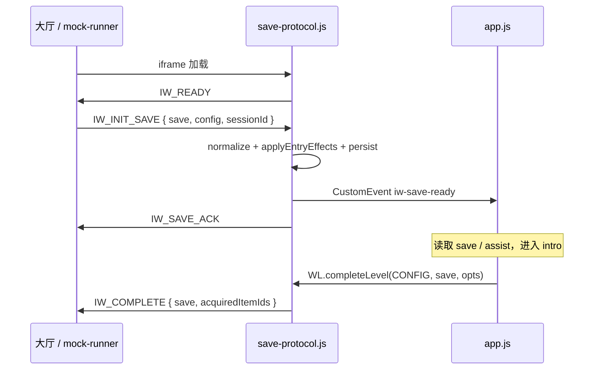

# 06 · 接力协议与宿主集成

本项目遵守「无限世界游戏接力黑客松」的 **SAVE_STATE v3** 协议。协议实现是官方文件 [game/shared/save-protocol.js](file:///home/songyx-15x/Project/treaHackson/game/shared/save-protocol.js)（847 行），**不得修改**；游戏只调用其 `WL.*` API。

## 1. 交付轨道

| 轨道 | 交付形态 | 入场 | 出场 | 本项目 |
|---|---|---|---|---|
| **A 轨（ZIP）** | 静态 ZIP，随包带 `shared/save-protocol.js` | `WL.readSave()` 或 `iw-save-ready` | `WL.completeLevel()` / `WL.failLevel()` | ✅ 使用 |
| **B 轨（外链）** | 长期公开 URL，引入官方 SDK | `await WL.ready()` | `await WL.complete()` / `WL.fail()` | 不适用 |

两种轨道**不能混用**：外链不能用 `readSave()` 代替 `ready()`，也不能用 `completeLevel()` 代替 `complete()`。本仓库的 `README.md` 与自测记录均声明为 A 轨。

## 2. 存档对象（SAVE_STATE v3）

### 2.1 结构

```jsonc
{
  "schema": "v3",
  "level": 4,
  "world": "失重第九小时",
  "player": {
    "hp": 1,              // 0 ~ max_hp
    "max_hp": 3,          // 1 ~ 10
    "level": 1,           // 1 ~ 10
    "sanity": 2,
    "status": "normal",   // normal | wounded | cursed | dead | specter
    "curses": [],         // 最多 8 条
    "deaths": 0           // 连续阵亡次数
  },
  "items": [],            // 跨关道具，最多保留最近 3 件
  "settled": [],          // 已结算的 on_enter 道具 id（防重复回血）
  "clues": [],            // 线索，交接时最多保留最近 2 条
  "exit_hook": "",        // 上家留下的结尾一句话
  "prev_world": "",
  "next_world": "",
  "tombstone": {          // 墓碑（失败交接时生成）
    "fallen_level": 0,
    "cause": "",
    "epitaph": ""
  }
}
```

### 2.2 读档宽容规则 `normalize()`

- 缺字段补默认值；多余字段忽略；类型自动转换。
- `max_hp` 夹到 `1~10`，`hp` 夹到 `0~max_hp`。
- `status` 不在白名单 → `normal`。
- `curses` 截断到 8 条，单条 40 字符。
- `items` 通过 `coerceItems()`：最多 3 件、名称 32 字符、id 64 字符、非法类型归为 `strange`、非法 `effect` 丢弃。
- `clues` 截断到最近 8 条（交接时再压缩到 2 条）。

### 2.3 道具与效果词表

`type` 只能是：

```text
key | tool | light | food | token | info | weapon | strange
```

`effect` 是**封闭词表**，不允许自由字段：

| `stat` | `value` 取值范围 | 作用 |
|---|---|---|
| `hp` | 1 或 2 | 进入下一关回血（不超过上限） |
| `sanity` | 1 | 理智 +1 |
| `max_hp` | 1 | 生命上限 +1（最多 10） |
| `cleanse` | 必须是布尔 `true` | 净化 1 项诅咒 |
| `attack` | 1 | 常驻攻击加成（由下一关读取） |

`trigger` 只能是 `on_enter`（进入下一关结算一次）或 `passive`（常驻，不结算数值）。

### 2.4 `on_enter` 结算去重

`applyEntryEffects(save)` 只对 `trigger === "on_enter"` 且未出现在 `settled` 中的道具结算，结算后把 id 写入 `settled`（保留最近 8 个）。因此刷新/换关卡不会重复回血。

### 2.5 放水档位 `assist(save)`

```js
const deaths = save.player?.deaths ?? 0;
return deaths >= 3 ? 2 : deaths >= 2 ? 1 : 0;
```

| 档位 | 条件 | 本项目表现 |
|---|---|---|
| 0 | 正常 | 标准难度 |
| 1 | 连续阵亡 ≥2 | 撞击扣氧 1（而非 3）、无敌 4 秒、抓取范围略大 |
| 2 | 连续阵亡 ≥3 | 初始 1 卷胶带、耗氧 ×0.55、陨石时间 ×0.65、扶手抓取 3.5m、培养舱 4m |

## 3. `WL` API 参考

### 3.1 同步 / A 轨接口

| API | 签名 | 说明 |
|---|---|---|
| `WL.readSave(levelNo?)` | `→ save` | 读档；优先级：内存 → URL `?save=` → `localStorage` → 默认；读后自动结算 `on_enter` |
| `WL.getInitialSave()` | `→ save` | 本关进入时的快照（用于复活） |
| `WL.respawn()` | `→ save` | 恢复到进入本关的快照，`deaths + 1` |
| `WL.assist(save)` | `→ 0/1/2` | 放水档位 |
| `WL.setPlayer(save, patch)` | `→ save` | 修改 `hp/max_hp/level/sanity/status/curses` |
| `WL.addItem(save, item)` | `→ save` | 加道具，超 3 件丢最早 |
| `WL.addClue(save, text)` | `→ save` | 加线索 |
| `WL.consumeAny(items, type)` | `→ item \| null` | 按类型取用并移除道具 |
| `WL.completeLevel(config, save, opts)` | `→ save \| null` | 校验出口 → 写档 → 过场 → 跳转；缺必填项返回 `null` |
| `WL.failLevel(reason, save?, config?)` | `→ relicSave` | 生成遗物、墓碑和满血下一代探索者 |
| `WL.forcePass()` | `→ relicSave` | 演示超时/强制失败 |
| `WL.validateExit(save, config, opts)` | `→ string[]` | 返回缺失项列表 |
| `WL.goTo(url, save)` | `void` | 带存档跳转 |
| `WL.renderOpening(save)` | `→ html` | 前情提要条 |
| `WL.renderSaveCard(save, level, world)` | `→ html` | 五行通关存档卡 |
| `WL.readHistory()` | `→ array` | 旅程记录（最多 64 条） |
| `WL.startRun(levelNo)` / `WL.resetRun()` | — | 开新局 / 清空 |
| `WL.encodeCode(save)` / `WL.decodeCode(code)` | — | base64 存档码 |
| `WL.mountDebug(save)` | — | 安装复制/导入/重置按钮 |
| `WL.escapeHtml(text)` | `→ string` | HTML 转义 |

### 3.2 异步 / B 轨 + SDK 接口

| API | 说明 |
|---|---|
| `WL.ready(options?)` | 等待宿主 `IW_INIT_SAVE`，默认 15s 超时 |
| `WL.complete(save, options?)` | 发送 `IW_REQUEST { action: "complete" }`，20s 回执超时 |
| `WL.fail(reason, save?, options?)` | 发送 `IW_REQUEST { action: "fail" }` |

### 3.3 品级/常量

```js
WL.version      // "v3"
WL.sdkVersion   // "1.0.0"
WL.sdkProtocol  // 1
WL.ITEM_TYPES   // 8 种类型
WL.TYPE_LABELS  // 类型中文名
WL.EFFECT_STATS // 5 种效果 stat
```

## 4. postMessage 协议

### 4.1 游戏/协议库 → 宿主

| 消息 | 时机 | 载荷 |
|---|---|---|
| `IW_READY` | 页面 `load` 或 `ready()` 请求时 | `{ protocolVersion: 1, sdkVersion: "1.0.0" }` |
| `IW_SAVE_ACK` | 收到并应用 `IW_INIT_SAVE` | `{ protocolVersion, sessionId }` |
| `IW_REQUEST` | `WL.complete()` / `WL.fail()` | `{ protocolVersion, sessionId, requestId, action, save, acquiredItemIds, reason }` |
| `IW_COMPLETE` | A 轨 `completeLevel()` 且 `CONFIG.itemManifest` 存在 | `{ type, save, acquiredItemIds, history? }` |
| `IW_FAIL` | `failLevel()` | `{ type, reason, fallenSave }` |
| `IW_SAVE` | `failLevel()` 续传 | `{ type, save: relicSave, history, failure: true }` |

> 本项目通过 A 轨 `completeLevel()` 触发 `IW_COMPLETE`，不手写 `postMessage`。

### 4.2 宿主 → 游戏

| 消息 | 作用 |
|---|---|
| `IW_INIT_SAVE` / `iw-init` | 注入存档与 `window.CONFIG`，派发 `iw-save-ready` |
| `IW_RESULT` | 对 `IW_REQUEST` 的回执：`{ sessionId, requestId, ok, error? }` |
| `IW_PROTOCOL_ERROR` | 协议版本不兼容，`ready()` 直接失败 |
| `IW_ADMIN_COMMAND` | 裁判指令，见下表 |

### 4.3 管理员指令

| `command` | 行为 |
|---|---|
| `heal` / `heal_player` | 回满血、`status = normal`，派发 `iw-admin` |
| `respawn` | `WL.respawn()`，派发 `iw-admin` |
| `skip` / `forcepass` | `WL.forcePass()`，生成遗物交接 |
| `reload` | `location.reload()` |
| `audio` | 只派发 `iw-admin`，由游戏切换声音 |

游戏侧监听：

```js
window.addEventListener("iw-admin", (e) => {
  if (e.detail.save) adopt(e.detail.save, true);
  if (e.detail.command === "audio") { /* 切换 */ }
});
```

### 4.4 时序图



## 5. 本项目的协议接入点

### 5.1 入口挂载

[game/index.html](file:///home/songyx-15x/Project/treaHackson/game/index.html) 在 `app.js` 之前：

```html
<script src="shared/save-protocol.js"></script>
<script>
  window.GameProtocol = {
    read: () => WL.readSave(),
    complete: (save, options) =>
      WL.completeLevel(window.CONFIG || {}, save, options),
  };
</script>
<script src="app.js"></script>
```

### 5.2 开局

```js
let save = window.GameProtocol.read();          // WL.readSave()
let state = initial(WL.assist(save));           // assist 决定初始装备
```

若存档晚到，`iw-save-ready` 会调用 `adopt()` 同步 `save`、`state.assist`、HUD 和开场钩子。

### 5.3 死亡与复活

```js
function rescue(medical) {
  if (medical) {
    WL.setPlayer(save, { hp: Math.max(0, save.player.hp - 1) });
    if (save.player.hp <= 0) save = WL.respawn();  // deaths + 1
  }
  state = restore(state, WL.assist(save), medical);
  ...
}
```

- 只有**氧气耗尽**扣血；撞击只增加漏气与耗氧。
- 越界 5 秒只扣 15% 氧气，不扣血。
- `respawn()` 后 `assist` 可能升级，`restore()` 会按新档位给胶带/回滚补给。

### 5.4 通关

```js
if (win) {
  if (window.parent !== window)
    result = window.GameProtocol.complete(save, {
      acquiredItemIds: [],
      exitHook: "供氧恢复后，培养舱的运输记录亮起：它的目的地，是一座早已注销的空间站。",
    });
}
```

- **`acquiredItemIds` 恒为 `[]`**：本关没有跨关道具，`game/global-items.json` 为空声明。
- 结束语指向下一世界，满足“留下悬念钩子”的叙事要求。
- `result === null`（交接未被接受）时显示“重试交接”，不会静默丢失结局。

### 5.5 失败

```js
result = WL.failLevel(
  "舱外回收任务终止，氧气花培养舱未能接回",
  save,
  window.CONFIG || {},
);
```

生成遗物 + 墓碑 + 满血下一代探索者，并通过 `IW_FAIL` / `IW_SAVE` 通知宿主。

### 5.6 独立打开时的行为

- `window.parent === window`：成功分支不调用 `complete`，只显示结局弹窗。
- 失败分支仍调用 `failLevel`；没有 `CONFIG.nextUrl` 时不会显示“进入下一关”浮层，但会写档并返回遗物存档。
- 若在独立页面调用 `completeLevel`（例如测试），缺少 `world/nextWorld/nextUrl/items/clues` 会返回 `null`，因此 `finish` 会进入“重试交接”分支。

## 6. 官方交付规则摘要

完整规则见 [participant-delivery-kit-v3.3.2/AGENT.md](file:///home/songyx-15x/Project/treaHackson/participant-delivery-kit-v3.3.2/AGENT.md)。与本项目直接相关的硬约束：

| # | 类别 | 要求 | 本项目状态 |
|---|---|---|---|
| 1 | 包体 | ZIP ≤12MB、解压 ≤40MB、≤250 文件、单文件 ≤35MB、入口 `index.html` | 通过（约 156KB / 6 文件） |
| 2 | 时长 | 最佳解法 270 秒内完成完整流程；前 5 秒安全 | 物理模拟约 125s + 6.5s 演出；开局 5 秒保护 |
| 3 | 状态契约 | 只读存档、道具 ≤3、线索 ≤2、效果词表封闭 | 空声明，`acquiredItemIds: []` |
| 4 | 禁用 API | 禁 `alert` / `confirm` / `top.location` / `parent.location` | 未使用 |
| 5 | 技术栈 | 相对路径、无 `.unityweb`/`.glb`/`.gltf`/`.ktx2` | 纯 JS + 程序化几何 |
| 6 | 版权/破甲 | 素材可商用、不打破第四面墙 | 程序生成 + Three.js MIT；叙事完整 |

### 6.1 道具声明

`game/global-items.json`：

```json
{"schema":"iw-global-items-v1","items":[]}
```

即使没有跨关道具也**必须单独上传**该文件。声明不包含 `player`、血量、存档、关序或下一关地址。

### 6.2 本地模拟器

[mock-runner.html](file:///home/songyx-15x/Project/treaHackson/participant-delivery-kit-v3.3.2/mock-runner.html) 模拟官方大厅：

- iframe 沙箱：`allow-scripts allow-pointer-lock allow-orientation-lock`（无 `allow-same-origin`、无 `allow-modals`）；
- 注入 `IW_INIT_SAVE`，`config` 含 `world`、`itemManifest`、`exitHook`；
- 捕获 `IW_READY` / `IW_SAVE` / `IW_COMPLETE` / `IW_FAIL`；
- 校验道具声明、效果词表、存档卡；
- 提供“模拟 300s 超时 / 失败熔断”。

因为无 `allow-same-origin`，`localStorage` 会失败，协议库自动使用内存存档；这也是产物必须打成经典脚本的原因。

## 7. 常见协议问题

| 现象 | 原因 | 处理 |
|---|---|---|
| 页面显示默认存档，读不到上家数据 | 页面加载后存档才到，只调用了一次 `readSave()` | 监听 `iw-save-ready`，用 `event.detail` 更新 `save` |
| 通关后宿主没收到事件 | 在独立标签页打开（`parent === window`），或没有 `CONFIG.itemManifest` | 必须在 iframe 中通过大厅/模拟器打开 |
| `completeLevel` 返回 `null` | 缺少 `items`、`clues`、`exit_hook`、`world`、`nextWorld` 或 `nextUrl` | 按 `validateExit` 补齐；本项目在 iframe 分支走 manifest 路径 |
| 刷新后重复回血 | 自己实现了 `on_enter` 结算 | 交给 `WL.readSave()` 的 `settled` 去重 |
| 沙箱内 `localStorage` 抛异常 | 无 `allow-same-origin` | 协议库已兜底；游戏不要直接访问 localStorage |
| 重复发送交接 | 结局被多次触发 | 用 `handoffSent` 标志保证只发一次 |
