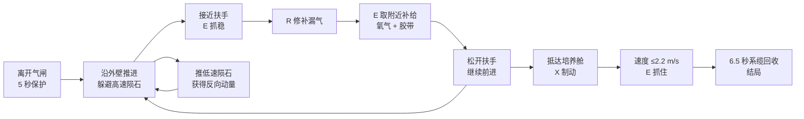

# 07 · 界面结构与玩法规则

本文覆盖 [game/index.html](file:///home/songyx-15x/Project/treaHackson/game/index.html)、[game/style.css](file:///home/songyx-15x/Project/treaHackson/game/style.css) 与玩法层的设计规则。DOM 元素的数值更新逻辑见 [04-main-loop-and-input.md](./04-main-loop-and-input.md#8-hud-更新-updatehud)。

## 1. 页面结构

```text
body
├── canvas#space                       第一人称 WebGL 画布
├── .visor                             头盔面罩 / 上下黑边 / 裂纹
├── #hit-flash                         受击闪光层
├── .hud#hud                           抬头显示（pointer-events: none）
│   ├── header
│   │   ├── .identity                  KEPLER 标识
│   │   ├── .heading                   NAV 罗盘 #compass
│   │   └── .mission-time              任务计时 #elapsed + #menu-button
│   ├── section.mission                主目标标题 + #objective + #sector
│   ├── #world-markers                 世界标记容器（由 View 动态填充）
│   ├── .reticle#reticle               准星（.active 表示可交互）
│   ├── .interact#interact             E 交互提示条
│   ├── .repair#repair                 修补进度条（默认 hidden）
│   ├── .alert#alert                   警告卡片（默认 hidden）
│   ├── .toast#toast                   4.6 秒提示
│   ├── .status-bottom
│   │   ├── .oxygen-panel              氧气 / 气密性 / 生命
│   │   ├── .flight-panel              速度 / 运动状态 / 辅助档位
│   │   └── .equipment-panel           推进器热量 / 胶带 / 机械臂
│   └── footer                         键位说明
└── .overlay#overlay
    └── section.modal                  开场简报 / 暂停 / 结局 / 错误
        ├── #modal-kicker / #modal-title / #modal-body
        ├── #briefing                  开场统计、操作说明、#previous、声音开关
        ├── #modal-primary             主按钮
        ├── #modal-secondary           次按钮（继续/声音）
        └── #abort-button              终止回收任务
```

### 1.1 关键 DOM id 一览

| 分组 | id |
|---|---|
| 画布 | `space` |
| 顶栏 | `compass`、`elapsed`、`menu-button` |
| 任务 | `objective`、`sector` |
| 交互 | `world-markers`、`reticle`、`interact`、`interact-key`、`interact-title`、`interact-detail` |
| 修补 | `repair`、`repair-bar` |
| 警告 | `alert`、`alert-title`、`alert-detail` |
| 提示 | `toast` |
| 氧气 | `oxygen`、`oxygen-status`、`reserve`、`oxygen-bar`、`leak`、`hp` |
| 飞行 | `speed`、`movement-state`、`assist` |
| 设备 | `heat`、`heat-label`、`heat-bar`、`tape`、`grip-status` |
| 弹窗 | `overlay`、`modal-kicker`、`modal-title`、`modal-body`、`modal-primary`、`modal-secondary`、`abort-button`、`briefing`、`previous`、`sound-enabled` |
| 受击 | `hit-flash` |

## 2. 视觉与 CSS 架构

### 2.1 设计变量

```css
:root {
  color-scheme: dark;
  --ice: #b6e7e7;
  --cyan: #7edcd5;
  --dim: #829da8;
  --orange: #ffc28b;
  --white: #eef4ed;
  --line: #91bdc52b;
}
```

整体是「冷色 HUD + 琥珀色警示 + 扫描线/面罩」的科幻 EVA 风格。

### 2.2 主要样式模块

| 区块 | 作用 |
|---|---|
| `html, body` | 全屏、禁止滚动、深色底 |
| `#space` | 100% 画布，`touch-action: none`，去掉焦点描边 |
| `.hud` | `position: fixed; inset: 0; pointer-events: none`，保证不挡鼠标 |
| `header` | 顶部三段式（身份 / 罗盘 / 计时） |
| `.mission` | 左上主目标卡片 |
| `.visor` / `.helmet-top` / `.helmet-bottom` / `.crack` | 头盔面罩、上下黑边、裂纹叠加 |
| `.reticle` | 准星；`.active` 时高亮 |
| `.interact` | 交互条；`.show` 时出现 |
| `.alert` | 警告卡片 |
| `.toast` | 居中偏下提示 |
| `.status-bottom` | 底部三栏仪表 |
| `.oxygen-panel` / `.flight-panel` / `.equipment-panel` | 氧气 / 飞行 / 设备 |
| `.marker` / `.diamond` | 世界标记，`pod/anchor/pack/optional` 不同配色 |
| `.overlay` / `.modal` | 全屏遮罩 + 居中弹窗 |
| `body.paused` | 暂停态（隐藏部分 HUD / 模糊） |
| `body.leaking` | 漏气态（面罩/边缘警示） |

### 2.3 响应式断点

| 断点 | 调整 |
|---|---|
| `max-width: 1000px` | HUD 边距、字号、面板宽度收缩 |
| `max-height: 680px` | 压缩纵向间距，避免底部面板遮挡 |
| `max-width: 650px` | 单列布局，弱化次要信息 |

游戏定位是桌面键鼠，移动端只保证“不破版”，不提供触控操作。

## 3. 世界观与目标

- 场景：KEPLER 空间站外壁，重力环停机第九小时。
- 目标：追回最后一株「氧气花」培养舱，接入主制氧回路。
- 玩家：穿着 EVA 航服，依赖氧气、胶带与机械臂。
- 终点：抓住培养舱把手，播放 6.5 秒系缆回收演出。

## 4. 操作规则

| 操作 | 键位 | 规则细节 |
|---|---|---|
| 观察 | 鼠标 | 指针锁定；不支持时可按住左键拖动；俯仰 ±81°，无侧滚 |
| 推进 | W/S/A/D | 相对视角；松键保留惯性（无阻力） |
| 升降 | Space / C / 左 Ctrl | 独立垂直轴 |
| 强推 | Shift | 加速度 4.8；约 3.7 秒过热；小幅推进始终可用 |
| 制动 | X | `v *= e^{-3.4dt}`；过热时仍可用 |
| 交互 | E | 抓/放扶手、取补给、推低速陨石、抓培养舱 |
| 修补 | R | 必须抓稳扶手 + 有胶带 + 有漏气；连续按住 3 秒；松键取消且不消耗 |
| 声音 | M | 开关航服音效 |
| 菜单 | Esc | 暂停；运动与氧气冻结，任务总计时继续 |

## 5. 核心玩法循环



### 5.1 资源

| 资源 | 上限 | 获取 | 消耗 |
|---|---|---|---|
| 氧气 | 100 | 补给包（+20/28/45） | 基础 0.45/s + 每级漏气 0.65/s |
| 胶带 | 5 | 补给包（+1/+2） | 每次完整修补 −1 |
| 生命 | 存档决定（最多 10） | 不可在本关回复 | 只有氧气耗尽 −1 |
| 推进器热量 | 100 | 自动冷却 19/s（抓握 27/s） | 强推 +27/s |

### 5.2 威胁

| 威胁 | 行为 | 应对 |
|---|---|---|
| 高速陨石（14 颗） | 从 +X 侧横掠，速度 4.5~5.8 m/s | 观察轨迹、利用护板/顶棚、抓稳扶手 |
| 舰体/太阳能板/破损结构 | 碰撞反弹 −0.35，速度 >1.6 触发撞击 | 减速绕行 |
| 低速陨石（5 块） | 可推，产生反向动量 | 用于借力或清路 |
| 漏气 | 撞击 +1 级（上限 3），耗氧加快 | 抓稳 + R 修补 |
| 越界 | 离开作业区累计 5 秒 | 自动牵引回最近扶手，扣 15% 氧气 |

### 5.3 生命与救援

- **撞击不直接扣血**，只造成漏气与额外耗氧。
- 氧气归零 → 扣 1 血 → 回到最近检查点，满氧、封堵漏气、补给回滚。
- 生命归零 → 调用官方 `WL.respawn()`，`deaths + 1`，并按新 `assist` 档位放水。
- 越界 → 不扣血，只扣 15% 氧气。
- 认输 → 暂停菜单 → “终止回收任务” → 二次确认 → `WL.failLevel()`。

## 6. 检查点与复活位置

| 检查点 | 位置 | 附近补给 |
|---|---|---|
| 气闸 | `[0,0,4]` | `pack-0` |
| 01 外壁扶手 | `[0,0,-14]` | `pack-1` |
| 02 翼板避难点 | `[3,3,-37]` | `pack-2` |
| 03 中继维护架 | `[2,2,-60]` | `pack-3` |
| 04 补给扶手 | `[4,0,-82]` | `pack-4` |
| 05 回收平台 | `[2,1,-104]` | — |

抓握检查点时会保存：

```js
checkpointTape = tape;
checkpointItems = [...collected];
```

因此“缺氧复活”会回到该检查点并恢复当时的补给状态；而“越界牵引”保留当前补给与漏气。

## 7. 培养舱抓取

| 条件 | 值 |
|---|---|
| 交互距离 | 3m（assist=2 时 4m） |
| 视线夹角 | `dot > 0.87`（约 29.5°） |
| 遮挡 | 不能隔着舰体/面板 |
| 速度 | ≤ 2.2 m/s，否则提示 `too-fast` |
| 成功后 | `captured = true`，速度归零，进入 `recover` |
| 演出时长 | 6.5 秒 |

培养舱会以 `0.055 m/s` 沿 `-Z` 远离，同时轻微上下浮动与右漂，因此需要主动追击并在接近时制动。

## 8. 难度与节奏设计

| 设计点 | 实现 |
|---|---|
| 270 秒目标 | 物理路线模拟约 125 秒 + 6.5 秒演出；DOM 模拟约 143 秒 |
| 1 血可通关 | 撞击不扣血，只有缺氧扣 1 血 |
| 开局 5 秒安全 | `time < 5` 时不耗氧、`impact()` 直接拒绝 |
| 就近复活 | 物理位置回最近检查点；存档层面 `WL.respawn()` 回到本关进入快照并 `deaths+1`，无长黑屏 |
| 动态放水 | `assist` 0/1/2 三档，见 [06-protocol-integration.md](./06-protocol-integration.md#25-放水档位-assistsave) |
| 防卡关 | 主路每段都有保底补给；空背包也能通关 |
| 无跨关道具 | `global-items.json` 为空；`acquiredItemIds: []` |

## 9. 推荐通关路线（来自自测记录）

1. 气闸外确认观察与 X 制动，取用附近应急包。
2. 沿外壁到 01 扶手，E 抓稳并取补给。
3. 穿越低速岩块与高速碎片区；接近 02 时向上、向右绕行。
4. 到 03 中继维护架；若漏气，抓稳后 R 修补。
5. 从下方绕过抬高的破损结构，到 04 补给扶手，补氧并修补。
6. 沿外侧绕过最后一块翼板，到 05 回收平台。
7. 接近培养舱，X 制动到 2.2 m/s 以下，E 抓住。
8. 观看 6.5 秒回收演出，进入结局「呼吸，重新开始。」

## 10. UI 状态与提示文案

| 状态 | 触发 | 表现 |
|---|---|---|
| 气闸保护 | `time < 5` | `oxygen-status = 气闸保护` |
| 循环正常 | 无漏气且已过 5 秒 | 青色 |
| 持续漏气 | `leak > 0` | 状态变橙，`body.leaking`，警告卡片 |
| 低氧 | `oxygen < 25` | 氧气条变橙，警告“氧气储量偏低” |
| 越界 | `outside > 0` | 警告“正在离开作业区” |
| 过热 | `overheated` | 热量条橙色，`heat-label = 冷却中` |
| 强推 | `boosting` | `heat-label = 增压中` |
| 制动 | `braking` | `heat-label = 反推制动` |
| 已抓握 | `anchor` | `grip-status = 机械臂 / 已锁定扶手` |
| 回收中 | `phase === recover` | `movement-state = 系缆回收` |
| 可交互 | `focus(state)` 命中 | 准星 `.active`，交互条出现 |

结局文案：

| 结局 | 标题 | 正文要点 |
|---|---|---|
| 成功 | 呼吸，重新开始。 | 氧气花接入主制氧回路；运输记录显示目的是一座已注销的空间站 |
| 失败 | 撤离信标已点亮 | 回收任务终止；航服把生命记录与遗物交给接续者 |
